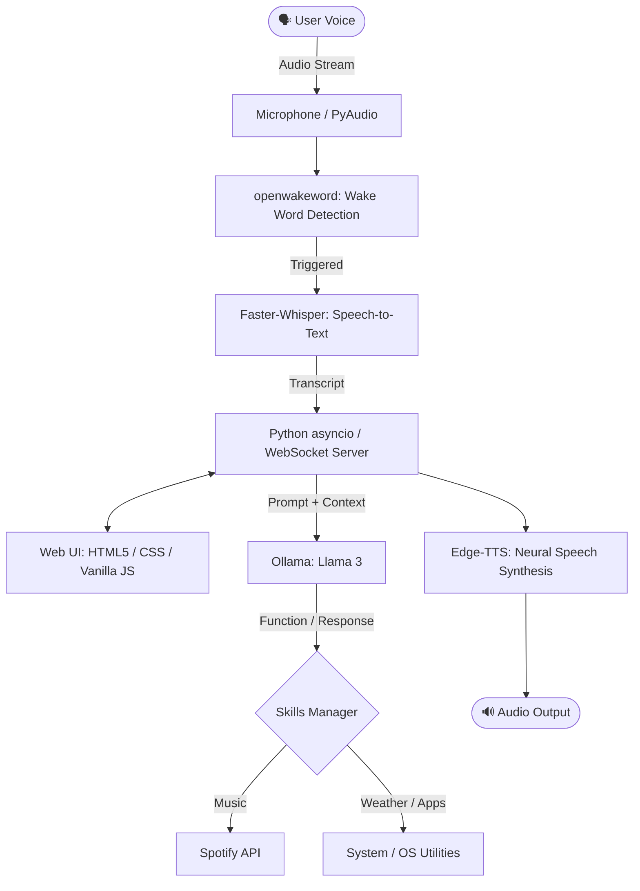

# 🎙️ DuzziAI — Autonomous Local Voice AI Assistant

[](https://www.python.org/downloads/)
[](https://ollama.ai)
[](https://github.com/SYSTRAN/faster-whisper)
[](https://github.com/rany2/edge-tts)
[](https://opensource.org/licenses/MIT)

**DuzziAI** is a private, real-time, 100% locally-executed personal voice AI assistant. It combines continuous hotword detection, speech-to-text, local LLM inference via **Ollama (Llama 3)**, text-to-speech synthesis, and a clean web-based reactive UI communicating over **WebSockets**.

---

## 🌟 Key Features

- **🔒 100% Local & Private:** Runs entirely on local hardware with zero external API fees for core intelligence.
- **⚡ Continuous Voice Pipeline:**
  - **Wake Word Detection:** Powered by `openwakeword` for real-time background listening with negligible CPU overhead.
  - **Speech-to-Text (STT):** High-speed local transcription using `faster-whisper`.
  - **Text-to-Speech (TTS):** Natural, fluid neural voice feedback via `edge-tts`.
- **🧠 Local LLM Reasoning:** Integrates with **Ollama** running Meta's `Llama 3` model for conversational memory and decision-making.
- **🛠️ Modular Extensible Skills:**
  - 🎵 **Spotify Controller:** Play, pause, search tracks, skip, and manage playlists via Spotipy API.
  - ⛅ **Real-Time Weather:** Live weather reporting by location.
  - 🚀 **App Launcher:** Voice-command desktop application execution.
  - ⏱️ **Timers & Utilities:** System commands, timers, and cryptographically secure password generation.
- **🌐 Reactive Frontend:** Interactive web dashboard with a dynamic pulsing orb indicator showing connection and speech state in real time over WebSockets.

---

## 🏗️ Architecture



---

## 🚀 Quick Start

### Prerequisites
1. **Python 3.10+**
2. **Ollama:** Installed and running locally.
   ```bash
   ollama run llama3
   ```
3. *(Optional)* **Spotify Developer Account:** If you want Spotify voice integration, create an app at [Spotify for Developers](https://developer.spotify.com/dashboard) and set the Redirect URI to `http://127.0.0.1:8888/callback`.

---

### Installation

1. **Clone the repository:**
   ```bash
   git clone https://github.com/IrguCap/duzzi-ai-assistant.git
   cd duzzi-ai-assistant
   ```

2. **Set up virtual environment:**
   ```bash
   python -m venv .venv
   # Windows:
   .venv\Scripts\activate
   # Linux/macOS:
   source .venv/bin/activate
   ```

3. **Install dependencies:**
   ```bash
   pip install -r backend/requirements.txt
   ```

4. **Environment variables:**
   Copy `.env.example` to `.env` and fill in your optional credentials:
   ```bash
   cp .env.example .env
   ```

5. **Start the assistant backend:**
   ```bash
   cd backend
   python server.py
   ```

6. **Launch the Interface:**
   Simply open `UI/index.html` in your browser. The glowing orb will turn **Gold/Active**, confirming the WebSocket connection. Say your wake word or interact through the UI!

---

## 📁 Project Structure

```
├── backend/
│   ├── audio_manager.py     # Microphone stream, WakeWord & Whisper STT
│   ├── llm_manager.py       # Ollama / Llama 3 prompt management & sessions
│   ├── skills_manager.py    # Modular tool execution (weather, apps, passwords)
│   ├── spotify_manager.py   # Spotify OAuth & playback control
│   ├── auth_spotify.py      # Spotify initial authorization helper
│   ├── server.py            # Asyncio WebSocket server & event dispatcher
│   └── requirements.txt     # Python dependencies
├── UI/
│   ├── index.html           # Main interface with reactive orb
│   ├── styles.css           # Glassmorphism & pulsing animations
│   └── app.js               # WebSocket client & visual state updates
├── .env.example             # Configuration template
├── .gitignore               # Ignored binaries, venv, and cache
└── README.md
```

---

## 📄 License

This project is licensed under the [MIT License](LICENSE).
